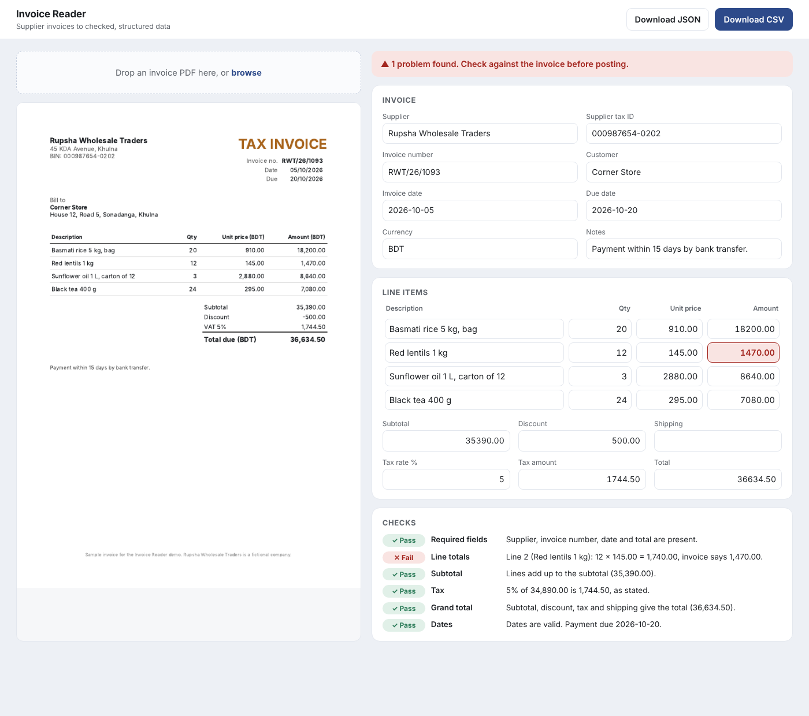

# Invoice Reader

Upload a supplier invoice PDF and get its fields as clean, structured data, with every number checked. Built with Python, FastAPI and Claude.

Typing supplier invoices into a spreadsheet or accounting system is slow, and mistakes slip through: a misread digit, or a supplier's own arithmetic error that nobody notices. This app reads the invoice with Claude, then checks the arithmetic itself, so problems are caught before anything is paid or posted.



## What it does

1. **Reads the invoice.** Supplier, tax ID, customer, invoice number, dates, currency, every line item, subtotal, discount, tax, shipping and total.
2. **Handles scanned invoices too.** If the PDF has a text layer, only the text is sent (cheaper). If it's a scan, the PDF itself is sent and Claude reads the page.
3. **Checks every number:**
   - each line: quantity × unit price = amount
   - the lines add up to the subtotal
   - the tax matches the stated rate (after any discount, allowing for rounding)
   - subtotal − discount + tax + shipping = total
   - required fields are present and the dates are valid, with the due date after the invoice date
4. **Shows problems clearly.** A wrong line is outlined in red, and each check says exactly what doesn't add up, for example: *Line 2 (Red lentils 1 kg): 12 × 145.00 = 1,740.00, invoice says 1,470.00.*
5. **Lets you correct and recheck.** Edit any field and the checks run again.
6. **Exports** CSV (one row per line item, ready for a spreadsheet or accounting import) or JSON.

## How the extraction stays reliable

- **A strict tool schema.** Claude must call a `record_invoice` tool (`tool_choice`), and the tool is marked `strict`, so the result always matches the schema: every field present, numbers as numbers, `null` when something isn't on the invoice.
- **No silent corrections.** Claude is told to copy numbers exactly as printed, even when the arithmetic looks wrong, and never to calculate missing values. The checks then catch errors in the open instead of hiding them.
- **Exact money.** Amounts are handled as decimals, never floating-point numbers, so 3 × 0.10 is exactly 0.30.

## Run it

Requires Python 3.10 or later and an Anthropic API key from [console.anthropic.com](https://console.anthropic.com).

```bash
python -m venv .venv
source .venv/bin/activate        # Windows: .venv\Scripts\activate
pip install -r requirements-dev.txt
cp .env.example .env             # then add your ANTHROPIC_API_KEY
uvicorn invoice_reader.app:app --reload
```

Open http://localhost:8000 and upload one of the files in `samples/`:

| File | What it shows |
| --- | --- |
| `padma-packaging-correct.pdf` | A correct invoice with 15% VAT and delivery: every check passes |
| `rupsha-wholesale-line-error.pdf` | A line total printed wrong (12 × 145 printed as 1,470): the line check fails |
| `bhairab-fittings-scanned.pdf` | A scanned invoice with no text layer: read from the page image |

The sample suppliers are fictional.

| Variable | Default | Meaning |
| --- | --- | --- |
| `ANTHROPIC_API_KEY` | none | Your key. Required. |
| `ANTHROPIC_MODEL` | `claude-sonnet-5-5` | The Claude model used |

API docs are at http://localhost:8000/docs while it runs.

## API

| Method | Path | What it does |
| --- | --- | --- |
| `POST` | `/api/extract` | Upload a PDF (`file` field); returns the fields, the checks and whether all passed |
| `POST` | `/api/check` | Send corrected fields; returns the checks again |
| `POST` | `/api/export.csv` | Send fields; returns a CSV file |

## Tests

```bash
pytest           # 22 tests
```

The tests use a stand-in for Claude that returns known fields, so they run without an API key or cost. They cover every check (passing, failing and skipped), rounding and exact decimals, reading the sample PDFs' text, sending a scanned PDF as a document, the strict forced tool call, the API endpoints and the CSV export.

## Project structure

```
invoice_reader/
  extract.py     PDF text, the Claude call, the record_invoice tool schema
  checks.py      the arithmetic and sanity checks
  models.py      invoice fields with exact decimal money
  export.py      CSV export
  app.py         FastAPI routes
static/index.html  the review screen
samples/       three sample invoices
tests/         22 tests
```

## Going further

- Process a folder or an email inbox of invoices in a batch.
- Match each invoice to its purchase order and flag price or quantity differences.
- Push approved invoices straight into accounting software.

## License

MIT
